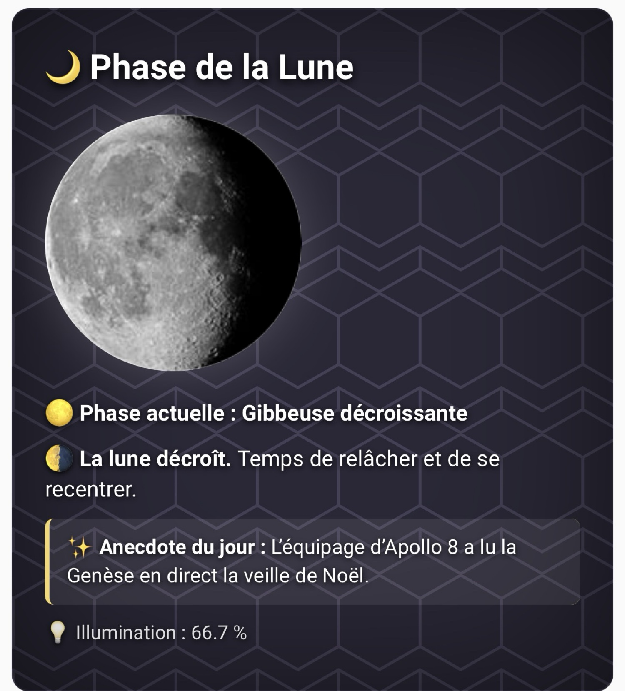
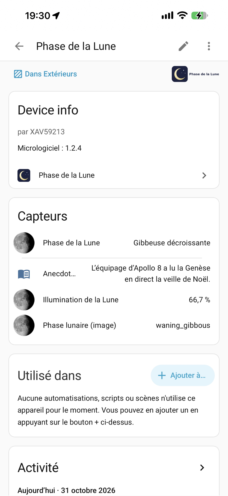
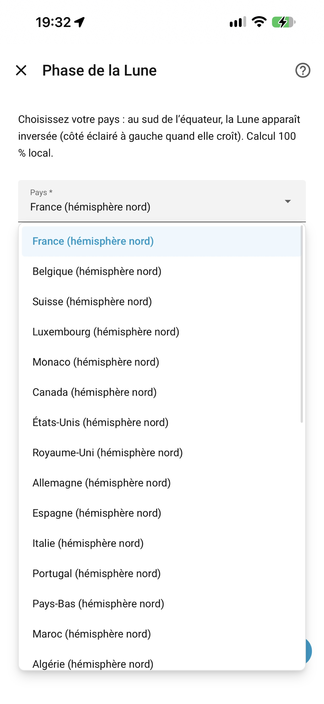

<p align="center"></p>

# 🌙 Phase de la Lune / Moon Phase — Home Assistant

[](https://hacs.xyz) [](https://github.com/XAV59213/phase_lune/releases/latest) [](https://github.com/XAV59213/phase_lune/actions/workflows/hassfest.yml) [](https://github.com/XAV59213/phase_lune/actions/workflows/hacs.yml) [](LICENSE) [](https://github.com/XAV59213/phase_lune/releases) [](https://github.com/XAV59213/phase_lune/releases/latest) [](https://www.home-assistant.io)

[](https://www.buymeacoffee.com/xav59213)

## Via HACS (recommandé)

[](https://my.home-assistant.io/redirect/hacs_repository/?owner=XAV59213&repository=phase_lune&category=integration)

[](https://my.home-assistant.io/redirect/config_flow_start/?domain=phase_lune)


**[🇫🇷 Français](#-français) · [🇬🇧 English](#-english)**

<p align="center">
  
  &nbsp;
  
  

</p>

---

> **1.2.3** : entity_id préfixés `phase_lune` (`sensor.phase_lune_slug`, `sensor.phase_lune`, `sensor.phase_lune_illumination`, `sensor.phase_lune_anecdote`) pour ne plus entrer en conflit avec l’intégration Moon du core (`sensor.moon_phase`). Migration automatique : les anciens `sensor.moon_phase`, `sensor.phase_de_la_lune`, `sensor.illumination_lune`, `sensor.anecdote_lune` (et `*_2`) de cette intégration ne sont plus créés et sont retirés du registre. S’il reste des entités orphelines (« Entité non disponible ») : Paramètres → Appareils et services → Entités → filtrer `moon_phase` / `phase_de_la_lune` / `_2` → sélectionner → Supprimer. Ne supprimez pas `sensor.moon_phase` de l’intégration Moon du core si vous l’utilisez.

## 🌍 Pays / hémisphère (1.2.0)
À l’installation, choisissez votre **pays** (défaut **France**) ; modifiable ensuite via *Configurer*. La phase (nom, illumination) est la même partout ; dans l’**hémisphère sud**, l’image est inversée (croissant ↔ décroissant). Attributs : `country`, `hemisphere`, `image_slug` (utilisez `image_slug` pour l’image : `/phase_lune/moon_phases/{{ state_attr('sensor.phase_lune_slug','image_slug') }}.png`). En France : aucun changement, image = état.

## 🇫🇷 Français

### Description
Intégration Home Assistant qui calcule **localement** (sans API, sans dépendance) la phase de la lune, son illumination et un texte poétique en français.

### Fonctionnalités
- **2 capteurs** :
  - `sensor.phase_lune_slug` → slug anglais (nom des images PNG) ; attributs `illumination`, `age_days`, `phase_fr`, `poetic`
  - `sensor.phase_lune` → libellé français ; attributs `illumination`, `age_days`, `phase_slug`, `poetic`
- **Illumination** en % (0–100) et âge lunaire en jours
- **Textes poétiques** pour chaque phase
- Icônes `mdi:moon-*` dynamiques, traductions FR/EN, configuration UI en un clic

### Carte Lovelace custom (1.1.0)
La carte `custom:phase-lune-card` est **chargée automatiquement** par l’intégration (aucune ressource à ajouter). Fond sombre hexagones, grande image de lune, phase actuelle, texte poétique (4 par phase, rotation quotidienne) et **anecdote du jour** (365 anecdotes uniques FR/EN, une par jour de l’année).

Tableau de bord → Modifier → Ajouter une carte → cherchez « Phase de la Lune », ou en YAML :
```yaml
type: custom:phase-lune-card
title: Phase de la Lune
entity: sensor.phase_lune
image_path: /phase_lune/moon_phases   # PNG incluses dans l'intégration (aucune copie)
language: fr                     # ou en
show_illumination: true
show_anecdote: true
```
Nouveaux attributs : `anecdote`, `anecdote_en`, `day_of_year`, `poetic_en`, `poetics`.

### Installation (HACS)

[](https://my.home-assistant.io/redirect/hacs_repository/?owner=XAV59213&repository=phase_lune&category=integration)

1. HACS → Intégrations → ⋮ → **Dépôts personnalisés**
2. Ajouter `https://github.com/XAV59213/phase_lune`, catégorie **Intégration**
3. Installer **Phase de la Lune**, puis redémarrer Home Assistant

Installation manuelle : copier `custom_components/phase_lune` dans `config/custom_components/`.

### Configuration
Paramètres → Appareils et services → **Ajouter une intégration** → « Phase de la Lune » → Valider. Aucune option (instance unique).

### Images
Depuis 1.1.2, les 8 PNG sont **fournies dans l'intégration** et servies via `/phase_lune/moon_phases/<slug>.png` (aucune copie). Optionnel : les copier dans `config/www/moon_phases/` pour `/local/moon_phases/`. Noms :

| État `sensor.phase_lune_slug` | `sensor.phase_lune` | Fichier |
|---|---|---|
| `new_moon` | Nouvelle lune | `new_moon.png` |
| `waxing_crescent` | Premier croissant | `waxing_crescent.png` |
| `first_quarter` | Premier quartier | `first_quarter.png` |
| `waxing_gibbous` | Gibbeuse croissante | `waxing_gibbous.png` |
| `full_moon` | Pleine lune | `full_moon.png` |
| `waning_gibbous` | Gibbeuse décroissante | `waning_gibbous.png` |
| `last_quarter` | Dernier quartier | `last_quarter.png` |
| `waning_crescent` | Dernier croissant | `waning_crescent.png` |

> Le dossier `www` nécessite parfois un redémarrage de HA après sa création.

📦 Les 8 images prêtes à copier sont dans [`media/moon_phases/`](media/moon_phases/) (incluses dans le zip HACS depuis 1.1.2, servies via `/phase_lune/moon_phases/<slug>.png` — aucune copie). Source/crédit : [papo-o/home-assistant-config](https://github.com/papo-o/home-assistant-config/tree/master/www/moon_phases) · [fil HA Community 86646](https://community.home-assistant.io/t/moon-platform-with-moon-phases-pictures/86646) — licence non précisée par l'auteur, redistribuées avec crédit ([détails](media/moon_phases/README.md)).

### Exemple de carte Lovelace (fond sombre)
```yaml
type: markdown
card_mod:
  style: |
    ha-card { background: #0b1020; color: #e8e8f0; text-align: center; }
content: |
  

  ## Phase actuelle : {{ states('sensor.phase_lune') }}

  *{{ state_attr('sensor.phase_lune','poetic') }}*

  Illumination : {{ state_attr('sensor.phase_lune','illumination') }} %
```
(`card_mod` est optionnel ; sans lui, utiliser un thème sombre.)

### Calcul
Âge lunaire = jours écoulés depuis une nouvelle lune de référence modulo le mois synodique (29,530588 j). Seuils alignés sur l’intégration Moon du core (échelle 0–28). Illumination ≈ `(1 − cos(2π·âge/29,530588)) / 2 × 100`. Précision : quelques heures.

### Documentation
Guides détaillés dans [`docs/`](docs/) (et le [wiki](https://github.com/XAV59213/phase_lune/wiki)) : [Accueil](docs/Home.fr.md) · [Installation](docs/Installation.fr.md) · [Lovelace](docs/Lovelace.fr.md) · [FAQ](docs/FAQ.fr.md)

### Contribution
Issues et pull requests bienvenues : [ouvrir une issue](https://github.com/XAV59213/phase_lune/issues). Merci de vérifier que les workflows Hassfest et HACS passent.

---

## 🌍 Country / hemisphere (1.2.0)
At setup, pick your **country** (default **France**); change it later via *Configure*. The phase (name, illumination) is the same worldwide; in the **southern hemisphere** the picture is mirrored (waxing ↔ waning look). Attributes: `country`, `hemisphere`, `image_slug` (use `image_slug` for the picture). In France: nothing changes, picture = state.

## 🇬🇧 English

### Description
Home Assistant integration that computes the moon phase, its illumination and a French poetic text **locally** (no API, no dependency).

### Features
- **2 sensors**:
  - `sensor.phase_lune_slug` → English slug (PNG image name); attributes `illumination`, `age_days`, `phase_fr`, `poetic`
  - `sensor.phase_lune` → French label; attributes `illumination`, `age_days`, `phase_slug`, `poetic`
- **Illumination** in % (0–100) and lunar age in days
- **Poetic texts** for each phase (French)
- Dynamic `mdi:moon-*` icons, FR/EN translations, one-click UI setup

### Custom Lovelace card (1.1.0)
The `custom:phase-lune-card` card is **loaded automatically** by the integration (no resource to add). Dark hexagon background, large moon picture, current phase, poetic text (4 per phase, daily rotation) and **fact of the day** (365 FR/EN facts, one per day of the year).

Dashboard → Edit → Add card → search “Phase de la Lune”, or YAML:
```yaml
type: custom:phase-lune-card
entity: sensor.phase_lune
image_path: /phase_lune/moon_phases   # PNGs shipped with the integration (no copy)
language: en
```
New attributes: `anecdote`, `anecdote_en`, `day_of_year`, `poetic_en`, `poetics`.

### Installation (HACS)

[](https://my.home-assistant.io/redirect/hacs_repository/?owner=XAV59213&repository=phase_lune&category=integration)

1. HACS → Integrations → ⋮ → **Custom repositories**
2. Add `https://github.com/XAV59213/phase_lune`, category **Integration**
3. Install **Phase de la Lune**, then restart Home Assistant

Manual install: copy `custom_components/phase_lune` into `config/custom_components/`.

### Configuration
Settings → Devices & services → **Add integration** → "Phase de la Lune" → Submit. No options (single instance).

### Images
Since 1.1.2, the 8 PNGs **ship with the integration** at `/phase_lune/moon_phases/<slug>.png` (no copy). Optional: copy them to `config/www/moon_phases/` for `/local/moon_phases/`. Names:

| `sensor.phase_lune_slug` state | `sensor.phase_lune` | File |
|---|---|---|
| `new_moon` | Nouvelle lune (New moon) | `new_moon.png` |
| `waxing_crescent` | Premier croissant (Waxing crescent) | `waxing_crescent.png` |
| `first_quarter` | Premier quartier (First quarter) | `first_quarter.png` |
| `waxing_gibbous` | Gibbeuse croissante (Waxing gibbous) | `waxing_gibbous.png` |
| `full_moon` | Pleine lune (Full moon) | `full_moon.png` |
| `waning_gibbous` | Gibbeuse décroissante (Waning gibbous) | `waning_gibbous.png` |
| `last_quarter` | Dernier quartier (Last quarter) | `last_quarter.png` |
| `waning_crescent` | Dernier croissant (Waning crescent) | `waning_crescent.png` |

> The `www` folder may require a HA restart after it is created.

📦 The 8 ready-to-copy images are in [`media/moon_phases/`](media/moon_phases/) (included in the HACS zip since 1.1.2, served at `/phase_lune/moon_phases/<slug>.png` — no copy needed). Source/credit: [papo-o/home-assistant-config](https://github.com/papo-o/home-assistant-config/tree/master/www/moon_phases) · [HA Community thread 86646](https://community.home-assistant.io/t/moon-platform-with-moon-phases-pictures/86646) — no license stated by the author, redistributed with credit ([details](media/moon_phases/README.md)).

### Lovelace card example (dark)
```yaml
type: markdown
card_mod:
  style: |
    ha-card { background: #0b1020; color: #e8e8f0; text-align: center; }
content: |
  

  ## Current phase: {{ states('sensor.phase_lune') }}

  *{{ state_attr('sensor.phase_lune','poetic') }}*

  Illumination: {{ state_attr('sensor.phase_lune','illumination') }} %
```
(`card_mod` is optional; without it, use a dark theme.)

### Calculation
Lunar age = days since a reference new moon modulo the synodic month (29.530588 d). Thresholds match the core Moon integration (0–28 scale). Illumination ≈ `(1 − cos(2π·age/29.530588)) / 2 × 100`. Accuracy: a few hours.

### Documentation
Detailed guides in [`docs/`](docs/Home.md): [Home](docs/Home.en.md) · [Installation](docs/Installation.en.md) · [Lovelace](docs/Lovelace.en.md) · [FAQ](docs/FAQ.en.md)

### Contributing
Issues and pull requests welcome: [open an issue](https://github.com/XAV59213/phase_lune/issues). Please make sure the Hassfest and HACS workflows pass.

---

## Licence / License
MIT © 2025-2026 XAV59213
